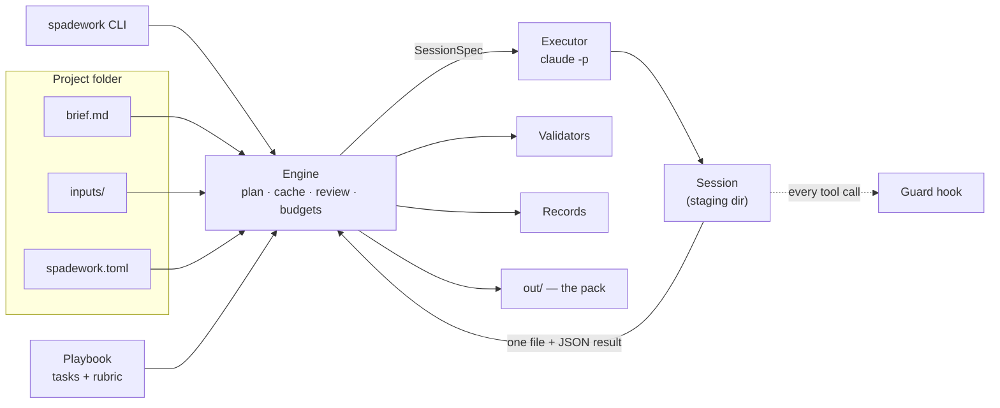

# 00 — Overview

Status: Implemented (v0.1)

spadework is a command-line tool that does the desk research for a project
that is in discovery. You write a short brief. spadework runs a *playbook* of
research tasks as isolated, sandboxed Claude Code sessions, reviews its own
work, and produces a short **research pack**: decisions, open questions,
risks, and sourced findings. When new information arrives, you rerun it, and
it redoes only the work that the new information affects.

## Problem

Discovery covers the first weeks of a project: client calls, requirements
gathering, and scoping. It is full of repetitive desk research: competitors,
comparable products, stacks and costs, regulations, audience. Doing it by hand
is slow. Doing it in a chat assistant produces output that is unsourced, hard
to reproduce, and hard to update when the client answers a question.

## Goals (v0)

1. **Brief in, pack out.** One command takes you from a brief to a reviewable pack.
2. **Evidence first.** Every external fact traces back to a source. Anything
   unsourced is labelled.
3. **Rerunnable.** New inputs, such as client answers or call notes, rerun
   only the affected work.
4. **Safe to leave running.** Sessions are sandboxed, so a run can proceed
   overnight on untrusted web content.
5. **Reusable.** Domain knowledge lives in playbooks, which are data. Nothing
   domain-specific lives in the engine.
6. **Bounded.** Explicit money and time budgets. A run never runs away.

## Non-goals (v0)

- A web UI or a hosted service.
- Model providers other than Claude. The executor interface allows them later.
- Parallel sessions.
- Chaining phases, where one pack feeds the next phase. **[later]**
- A general-purpose agent framework.
- Replacing human judgement. The pack is a starting point for a human to review.

## Who it is for

Freelance developers and small agencies scoping a client project,
consultants, and product people evaluating an idea. Typically the person who
writes the brief is the person who reads the pack.

## Concepts

| Term | Meaning |
|---|---|
| **Project** | A folder for one engagement. Holds config, the brief, inputs, the pack, and engine state. |
| **Brief** | `brief.md`: the ground truth about the project. YAML front matter plus free text. |
| **Public context** | The part of the brief that may be sent to web-facing sessions. Written by the user on purpose. |
| **Inputs** | `inputs/`: material added later, such as call notes, client answers, and emails. Changes to it make dependent tasks stale. |
| **Playbook** | A reusable recipe: a set of tasks, a review rubric, and summary instructions. Data only, no code. |
| **Task** | One unit of research that produces one document in the pack. |
| **Session** | One isolated agent invocation that performs one step of a task: research, draft, repair, critic, fix, or summary. |
| **Executor** | The adapter that runs a session. v0 ships `claude-cli`, which runs `claude -p`. |
| **Guard** | The hook that checks every tool call a session makes against that session's policy. |
| **Record** | A session's structured result: key facts, decisions, open questions, risks, gaps, sources. |
| **Source** | A cited web page, with a verbatim quote that supports a claim. |
| **Round** | One review pass: a critic session, then fix sessions for the documents it flagged. |
| **Pack** | The output in `out/`: a summary, one document per task, sources, and `pack.json`. |
| **Run** | One invocation of `spadework run`. Described by a run manifest. |

## Architecture

## What happens during `spadework run`

1. **Load and validate** the config, brief and playbook. This is the same
   work `spadework check` does.
2. **Plan.** Order the tasks by their dependencies, compute a fingerprint for
   each task, and mark each one fresh or stale.
3. **Draft.** For each stale task: a research session (if the task has
   research), then source verification, then a draft session, then validation
   (with one repair session if validation fails).
4. **Review.** Up to *N* rounds of critic, then fixes, then validation. Stop
   when the critic says ship, the round limit is reached, or the budget runs out.
5. **Summarise.** Write the pack summary from the records and documents.
6. **Render** the pack into `out/` and write the run manifest.

Details are in [04 — Engine](04-engine.md).

## Design principles

1. **One session, one job, one output.** Every session starts with fresh
   context. State lives on disk, not in a long conversation.
2. **Enforce in code, not in prompts.** Anything that matters, such as the
   sandbox, length limits, result schemas and budgets, is checked by the
   engine. Prompts explain the rules, but they are never the only defence.
3. **Least privilege by construction.** A session sees only the files staged
   for it, and it can write at most one file.
4. **Data over code.** Domain knowledge belongs in playbooks. The engine
   stays generic.
5. **Human-readable state.** Everything spadework knows is a JSON or Markdown
   file you can open.
6. **Respect human edits.** A document the user has edited by hand is never
   silently overwritten.
7. **Testable offline.** The whole engine runs against a fake executor. CI
   never spends money on model calls.
8. **Honest output.** Unverified claims are labelled, and gaps are reported
   rather than papered over.

## Background

spadework began as a one-off script. It ran nine research tasks overnight to
scope a small manufacturer's website. Using it taught the lessons this design
is built on:

| What happened | Design response |
|---|---|
| Length limits that existed only in prompts were exceeded | Validators run in code, and each failure triggers a repair session ([03](03-playbooks.md)) |
| Sessions could write the files that controlled later sessions | The control plane lives outside the sandbox ([07](07-security.md)) |
| One session held confidential context, web content, and an outbound channel at once | Research sessions are split from writing sessions ([07](07-security.md)) |
| New client input arrived after the run and had nowhere to live | `inputs/` plus fingerprinted reruns ([02](02-project-layout.md), [04](04-engine.md)) |
| The run stopped early, and nothing recorded why | A run manifest is written on every exit ([04](04-engine.md)) |
| Documents narrated their own revision history | Documents state the current truth, and history stays in the manifest |
| The critic was asked to catch fabrication but had no way to check | Quotes from sources are verified mechanically ([06](06-records.md)) |

## Where this is heading **[later]**

Discovery is the first phase. The same engine can run later phases. The open
questions from a discovery pack go to the client. The answers come back as
inputs. A build-planning playbook then starts from the decisions already made.
See the [roadmap](../roadmap.md).
