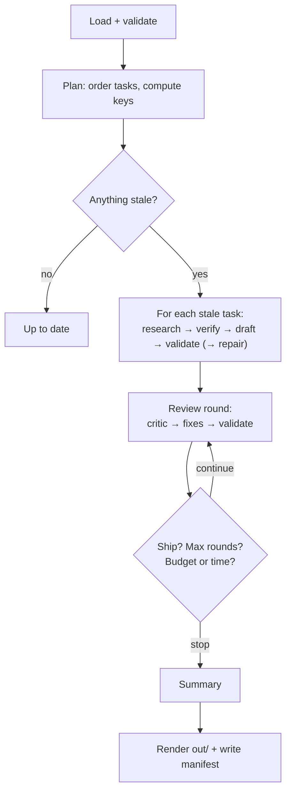

# 04 — Engine

Status: Draft · Target: v0.1

The engine turns a project and a playbook into a pack. It is a small,
deterministic orchestrator: a dependency sort, a cache, and a review loop
around isolated sessions
([ADR 0003](../decisions/0003-fresh-session-per-unit.md),
[ADR 0005](../decisions/0005-no-agent-framework.md)). v0 runs one session
at a time.



## Planning

- Tasks form a DAG through `depends_on`. `check` rejects cycles and unknown ids.
- Execution order is a topological sort, with ties broken by task id.
- With `--only`, only the named tasks are scheduled. Their dependencies are
  not rerun, and their existing outputs are used. If a dependency has never
  produced an output, that is an error.

## Session kinds

| Kind | When | Sees (staged, read-only) | Tools | May write | Returns |
|---|---|---|---|---|---|
| `research` | stale task with `research` | Nothing on disk. The prompt holds public context and the questions. | WebSearch, WebFetch | nothing | `ResearchResult` |
| `draft` | stale task | brief, matching inputs, dependency outputs, research notes and sources | Read, Glob, Grep, Write, Edit | its output | `DraftResult` |
| `repair` | validators failed | same as draft, plus the failure messages | same as draft | its output | `DraftResult` |
| `critic` | each review round | brief, all outputs, records digest | Read, Glob, Grep | nothing | `CriticResult` |
| `fix` | a document has findings | brief, its output, its findings, its sources | Read, Glob, Grep, Write, Edit | its output | `FixResult` |
| `summary` | end of run, if any output changed | brief, all outputs, all records | Read, Glob, Grep, Write | `00-summary.md` | `SummaryResult` |

Result schemas are in [06 — Records](06-records.md). How a session is
isolated is in [07 — Security](07-security.md).

A session works on a staged copy of its output. After the session, the engine
validates the copy and then moves it into `.spadework/work/`. Rendering into
`out/` happens once, at the end of the run.

## Fingerprints and staleness

Each task has a **draft key** and, if it has research, a **research key**.
Both are SHA-256 hashes over canonical JSON.

| Key | Inputs |
|---|---|
| research key | engine prompt version, the rendered research questions, the research model |
| draft key | engine prompt version, the playbook name and version, the task file's content, the brief's content, the content of each matching input file, the draft model, the task's research key, **and the draft keys of its dependencies** |

Dependencies contribute their *keys*, not their output text. Fixes applied
during review change output text without changing any key, so review can
never cause redrafts. A change upstream still propagates downstream.

| State | Meaning |
|---|---|
| `pending` | Has never run |
| `fresh` | The key matches the last successful draft |
| `stale` | The key changed. The reason is recorded, for example *brief changed*, *inputs/x.md added*, *dependency ia is stale*, *playbook 0.1.0 → 0.2.0*. |
| `failed` | The last attempt errored |
| `invalid` | An output exists, but validators still fail after repair |
| `pinned` | A human edited the output ([02](02-project-layout.md#human-edits)) |

Research results are reused while the research key matches, even when the
draft is redone. Use `--refresh-research` to force fresh research. A maximum
age for research results is **[later]**.

## Review loop

```
for round in 1..rounds:
    stop if the budget or time left cannot cover a critic plus one fix
    critic → findings, plus a finding for each validator failure (added by code)
    stop if verdict == ship and no validator is failing
    for each target document with findings, in task order:
        pinned → record the findings for the summary and skip
        fix session → validate → (repair once if needed)
```

- The review loop runs when any task was drafted in this run. It reviews the
  whole pack, because contradictions can involve documents that did not change.
- A fixer can reject a finding and say why. Rejections are recorded in the
  manifest and never written into the document.
- Findings that name an unknown file are dropped and logged.
- The default is 2 rounds.

## Summary

The summary runs at the end of any run that changed an output. The session
writes the prose parts of `00-summary.md`: an executive summary of at most 12
bullets, the key decisions with reasons, and at most 10 consolidated open
questions. The engine appends sections rendered by code, so they are always
accurate:

- a table of documents with state, validator results and gaps
- source verification counts
- the "How this pack was produced" footer: date, spadework, playbook and
  executor versions, total cost, and a note that the pack is automated
  research for a human to review

## Budgets and limits

| Limit | Enforced by |
|---|---|
| Run budget (`budget_usd`) | The engine does not start a session if `spent + estimate > budget`. The estimate is the task's `budget_usd`, or the default for that session kind. The summary's estimate is **reserved** at the start of the run, so the pack always gets a summary. |
| Per-session cap | The CLI flag `--max-budget-usd = min(1.5 × estimate, remaining)` |
| Run time (`max_time`) | The engine checks before each session. The guard denies tool calls after the deadline. |
| Session timeout | `min(session_timeout, remaining time − 30 s)`. On timeout, the process group is killed. |
| Research tool calls | The guard counts WebSearch and WebFetch calls against `max_searches` and `max_fetches` |
| Total tool calls per session | The guard enforces a cap (default 80) to stop runaway loops |

Default estimates: research $0.75, draft $1.00, repair $0.40, critic $1.00,
fix $0.50, summary $0.50.

**Rate limits.** A `rate_limit_event` with a non-allowed status, or a
recognised rate-limit error, stops the run cleanly. The manifest records the
reset time, and the CLI exits `6` and prints *resume after HH:MM*. With
`--wait-on-rate-limit`, the engine sleeps until the reset plus 60 s, provided
that fits within `max_time`. OS schedulers such as launchd, systemd timers
and cron are the user's choice and are not built in.

**Retries.** A transient executor error (the process exits without a
result) is retried up to 2 times, waiting 10 s and then 30 s. Timeouts, budget
stops and schema failures after one retry are not retried.

## Durability

- `state.json` is written atomically, to a temporary file followed by
  `os.replace`, after every session.
- Progress through the review rounds is persisted. If a run is interrupted
  and restarted, it resumes the current round and does not redraft fresh tasks.
- **Lock.** `.spadework/lock` is created with `O_EXCL` and holds the pid,
  the host and the start time. A lock whose pid is dead on the same host is
  reclaimed with a warning. Otherwise the CLI exits `7`.

## Run manifest

`.spadework/runs/<run-id>/manifest.json` is written on **every** exit path,
including errors and interrupts. The run id is a UTC timestamp plus 4
random hex characters, for example `20260927T210411Z-3f9a`.

```json
{
  "schema_version": 1,
  "run_id": "20260927T210411Z-3f9a",
  "spadework_version": "0.1.0",
  "executor": { "name": "claude-cli", "version": "2.1.278" },
  "playbook": { "name": "discovery-website", "version": "0.1.0" },
  "limits": { "budget_usd": 6.0, "max_time_s": 7200, "rounds": 2 },
  "started_at": "2026-09-27T21:04:11Z",
  "ended_at": "2026-09-27T21:47:02Z",
  "outcome": "complete",
  "sessions": [
    {
      "n": 1, "task": "scope", "kind": "draft", "round": 0,
      "model": "sonnet", "key": "sha256:…", "status": "ok",
      "cost_usd": 0.21, "duration_s": 72.4,
      "usage": { "input_tokens": 0, "output_tokens": 0, "cache_read_tokens": 0 },
      "tool_calls": { "Read": 3, "Write": 1 },
      "guard_denials": 0,
      "validators": [{ "name": "max_lines", "ok": true }],
      "rejected_findings": [],
      "log": "sessions/001-scope-draft.jsonl"
    }
  ],
  "totals": { "cost_usd": 3.12, "sessions": 17, "guard_denials": 0 }
}
```

`outcome` is one of `complete`, `partial`, `budget`, `time`, `rate_limited`,
`interrupted`, or `error`, and it matches the exit code ([01](01-cli.md#exit-codes)).
