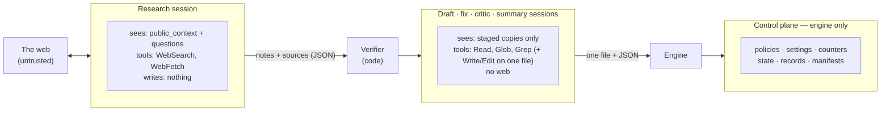

# 07 — Security

Status: Implemented (v0.1)

spadework runs AI sessions unattended, and some of them read untrusted web
content. The design assumes that **any web page may contain instructions
aimed at the model**, and it makes sure that obeying them cannot hurt the
user. This document is normative. A change that weakens an invariant needs
an ADR.

## Threat model

| | |
|---|---|
| **Assets** | ① Confidential project information (the brief and inputs). ② The user's machine: files, credentials, shell. ③ The user's money and usage quota. ④ The integrity of the pack a human will act on. |
| **T1 — prompt injection via web content** *(primary)* | A fetched page tells the model to exfiltrate data, tamper with the sandbox, poison later sessions, or write misleading content. |
| **T2 — a malicious or careless third-party playbook** | Pursues the same goals through templates and prompts. |
| **T3 — model error** | The model writes somewhere it shouldn't, loops, or overspends. |
| **T4 — malicious source URLs during verification** | Server-side request forgery (SSRF) against the user's local network. |
| **Out of scope** | A compromised Claude Code binary or Python environment. A user who deliberately turns protections off. Supply-chain risk is reduced separately with a minimal set of dependencies and a lockfile. |

## Invariants

Every invariant has an enforcement mechanism and tests: I1–I7, I10 and I11
in `tests/security/`, I8 in `tests/test_render.py` and
`tests/test_playbook.py`, and I9 in `tests/verify/`.

### I1. No code execution, no delegation, no MCP

Every kind of session has an explicit tool **allowlist** ([04](04-engine.md#session-kinds)).
Shell, REPL, notebook, subagent (`Task`/`Agent`) and MCP tools are never
available. Enforced four times: by the CLI `--tools` list, which the
executor checks against the tools the session actually reports; by
`--strict-mcp-config` and `--setting-sources ""`, so no MCP server or plugin
is loaded; by `--permission-mode dontAsk`, so no tool runs without the
guard's approval; and by the guard, which denies any tool not on the
allowlist, including every `mcp__*` name. The guard can only ever allow the
tools it knows how to check (`Read`, `Glob`, `Grep`, `Write`, `Edit`,
`WebSearch`, `WebFetch` and `StructuredOutput`), and it denies any tool
argument it doesn't recognise.

### I2. Reads are confined to the staging directory

Each session runs in a fresh staging directory that holds **copies** of only
the files it needs. The guard resolves every path argument (`file_path`,
and the `path` of Glob and Grep) against the staging directory, applies
`realpath`, and requires the result to be inside the staging directory,
comparing whole path components. Paths starting with `~` are denied, and so
is any path or pattern with leading or trailing whitespace, a control
character, or more than 4096 bytes, and brace nesting in a pattern is
limited to 16 levels: the CLI trims Glob's and Grep's `path`
after the hook has seen it, so `" /etc"` would otherwise be checked as a
folder inside the staging directory and read as `/etc`. Glob's
`pattern` and Grep's `glob` must be relative and must not contain `..`: brace
alternatives are expanded and each one is checked, and backslashes are
denied. Grep's `pattern` is a regular expression, not a path. Restricted mode
([05](05-executors.md)) confines the file tools to the staging directory as
an independent second layer.

### I3. At most one writable path, matched exactly

The policy lists the exact absolute paths that may be written: zero for
research and critic sessions, one for all the others. Write and Edit calls to
any other path are denied, even inside the staging directory. The match is on
the exact resolved path, so case and Unicode-normalisation variants are
denied. After a
session, any file in the staging directory other than the expected output
produces a warning and is never copied back.

### I4. Sessions cannot reach the control plane

Guard policies, settings files, tool-call counters, the deadline, state,
records and manifests all live in `.spadework/` **outside** every staging
directory. Sessions can neither read nor write them. The engine regenerates
the policy and settings for **each** session and never reuses them between
sessions.

*(This is the flaw in the prototype. Sessions could write the settings file
that configured the guard for the next session.)*

### I5. No session has both confidential context and web access

This breaks the "lethal trifecta" of private data, untrusted content and an
outbound channel in the same session.

- **Research sessions** see only `public_context` and the research
  questions, plus the call limits and today's date: not the task title, the
  reader, or the house rules. They run in an empty directory under the OS temporary
  directory, because the CLI tells the model its working directory, and a
  project path can name the client. The settings file also turns off the
  git status and memory blocks that the CLI would otherwise inject
  ([05](05-executors.md)). The questions are rendered from a template context that
  contains nothing else ([03](03-playbooks.md#templates)). They are rendered
  in a fresh template environment with no cache, so nothing a task body
  rendered earlier can reach them. Their staging directory is empty, and they
  write nothing to disk.
- **Every other session** has no WebSearch or WebFetch.
- `spadework check --show-public` shows exactly what research sessions will see.

### I6. The guard fails closed

The guard denies the call when the payload cannot be parsed, the policy is
missing or invalid, the tool is unknown, the deadline has passed, or the
guard hits an internal error.

### I7. Everything is bounded

Per-session caps on tool calls (searches, fetches, total calls), per-session
and per-run budgets, and per-session and per-run time limits. They are
enforced by the engine, the CLI's `--max-budget-usd`, and the guard (the
deadline and the counters).

### I8. Playbooks cannot run code

Templates are rendered with Jinja2's `SandboxedEnvironment` and
`StrictUndefined`, with no filesystem loader beyond the playbook's own
directory. Playbooks cannot declare hooks, tools, executors or code
validators ([ADR 0004](../decisions/0004-playbooks-are-data.md)).
Playbook paths must stay inside the playbook directory, and the project
folder must not be inside the playbook folder, so a template cannot include
`brief.md`.

### I9. Verification fetches cannot reach private networks

The verifier allows only `http` and `https` URLs without credentials, and
refuses single-label host names and special-use names (`.example`,
`.invalid`, `.test`, `.localhost`, `.local`, `.internal`, `.home.arpa`,
`.onion`, `.alt`, the home and corporate network suffixes `.lan`, `.home`,
`.corp`, `.intranet` and `.private`, the reverse-DNS zones `.in-addr.arpa`
and `.ip6.arpa`, and the bare labels `example`, `invalid`, `test` and
`localhost`) without any DNS lookup; the guard's WebFetch check refuses the
same names, offline and before the caps. It resolves the name as an absolute name
(so DNS search domains never apply), and every address must pass the
guard's public-address rules (see "The guard"). It then connects only to an address it checked,
sending the name in `Host` and in TLS SNI, so DNS rebinding cannot move the
connection. The full check repeats on **every** redirect, with at most 5
redirects, and loops are stopped. It sends only `User-Agent:
spadework/<version>`, `Accept`, `Accept-Encoding: gzip, deflate` and
`Connection: close`: no cookies, credentials or auth headers, and no proxy or
netrc settings from the environment. It reads at most 2 MB, counted on the
wire and after decompression, and each page has 10 s in total, including
every DNS lookup and redirect. It reads the page in a separate process with
its own 10 s limit and a CPU limit, so a hostile page cannot stall the run.
Status details never repeat text from the server.

### I10. spadework itself writes only inside the project

The only exceptions are the user's Claude Code installation, which manages
its own files under `~/.claude` (kept to a minimum by
`--no-session-persistence`, though it still keeps its own configuration
files and a short-lived socket in the temporary directory), and the OS
temporary directory, where research sessions and `doctor --canary` are
staged in `spadework-*` folders that are removed afterwards.

### I11. Denials are visible

Every guard denial is logged with the tool call that triggered it, counted
in the manifest (`guard_denials`), and shown in the live view. Calls that
Claude Code refuses before the guard sees them (see [05](05-executors.md))
are blocked too, but are not counted as denials. A research
session with denials is flagged in the summary as *possible prompt injection
encountered*.

## Trust boundaries



## The guard

It is configured as a `PreToolUse` hook with matcher `*` in each session's
generated settings file:
`<python> -I -m spadework.sandbox.guard --policy <abs path in .spadework/control/> --event pre-tool-use`.
`-I` stops a staged file or `PYTHONPATH` from shadowing a module the guard
imports. The same command with `--event session-start` runs as a
`SessionStart` hook: it checks that the policy loads and that the session's
working directory is the policy's, prints nothing, and lets the executor
confirm that the guard is live ([05](05-executors.md)).

**Policy file**, written by the engine and unreachable by the session:

```json
{
  "schema_version": 1,
  "session_id": "003-references-research",
  "workdir": "/tmp/spadework-k2j9x1",
  "allowed_tools": ["WebSearch", "WebFetch", "StructuredOutput"],
  "writable": [],
  "deadline_epoch": 1790550000,
  "caps": { "WebSearch": 6, "WebFetch": 8, "total": 80 },
  "counters_path": "/…/.spadework/control/003-references-research.counters.json",
  "denials_path": "/…/.spadework/control/003-references-research.denials.jsonl"
}
```

**Checks, in order:** parse the payload → load the policy → deadline → tool
is on the allowlist → per-tool argument checks that need no network → caps
(counters incremented under a file lock) → for `WebFetch`, the DNS check →
allow. A call over its cap therefore never causes a DNS lookup, and a
`WebFetch` that the DNS check then denies still counts against
`max_fetches`.

- Per-tool arguments are the path and pattern rules of I2 and I3, and for
  `WebFetch`: an `http(s)` URL with no credentials, whose host is public.
  An IP literal is read the way a browser's URL parser reads it (`127.1`, hex,
  octal and decimal forms included). A name is resolved, and every address
  it resolves to must be public, including addresses embedded in
  IPv4-mapped and NAT64 forms. An address is public only if it lies outside
  every block in the IANA special-purpose address registries and outside
  multicast; for IPv6, only `2000::/3` can be public. This is an explicit
  list, so the answer is the same on every supported Python version. Some
  addresses that look public are local too: the Azure WireServer address
  `168.63.129.16` is denied, single-label host names are refused, and an
  address equal to the machine's own source address for that destination
  (or, for IPv6, in the same /64) is denied.
- `StructuredOutput`, the tool that returns the session's result, is on every
  allowlist and is never counted or capped, so a session that has used up its
  tool calls can still report.
- The guard answers with a JSON `permissionDecision` of `allow` or `deny`
  and exit code `0`. A denial carries a one-line reason that the model sees.
  If the payload or policy is unusable, it exits `2` with one line saying so
  (for example *the hook payload is not valid JSON*); after any other error
  it exits `2` with a generic `internal error`. Exit `2` blocks the call.
  Messages never contain control-plane paths or exception details.
- On success, `--event session-start` writes `<session_id>.alive`, holding
  the session id, next to the policy. The executor checks it at `init`.
- Every denial is appended to the session's denials log as
  `{ts, tool_name, reason, target}`. `target` drops a URL's credentials,
  query and fragment.

The guard is plain standard-library Python. It imports nothing outside the
standard library, starts fast, and is easy to audit.

## Residual risks

| Risk | Mitigation | Status |
|---|---|---|
| Injected web content biases research notes, which leads to misleading content in the pack | Quote verification, the critic's fabrication test, `[unverified]` labelling, human review, denial flags | Reduced, not eliminated. The pack must be reviewed by a human. |
| The user puts confidential information in `public_context` | Required field, `check --show-public`, and documentation | User's responsibility |
| Search queries reveal terms taken from `public_context` to the search provider | Inherent to web research | Accepted |
| A Claude Code bug weakens `--tools` or the hook | Several layers; `doctor --canary` checks live that a read outside the workdir and a write to a second file are both denied | Monitored |
| If the guard is not running, the CLI still allows Read, Glob and Grep inside the working directory | Restricted mode confines them; the executor's liveness checks kill a session whose guard did not start or did not answer | Reduced |
| DNS rebinding: a name resolves to a public address for the guard and to a private one when the CLI's WebFetch fetches it | Closing it needs the fetcher to pin the address (a future executor with its own web tools) or OS-level egress rules. spadework's own verifier pins the address, so it is not affected. | Accepted for v0 |
| The verifier's page-reading process has a memory limit only where the OS enforces `RLIMIT_AS` (Linux); a 2 MB page can peak at about 200 MiB | The input is capped at 2 MB and the text at 4 million characters | Accepted |
| Organisations whose internal networks use public address space | Beyond the own-address checks, spadework cannot tell these apart from the internet. A user-configurable deny list is **[later]**. | Accepted |
| A research session leaks what it knows through search queries or URLs to public hosts | It knows only `public_context` (I5) | Accepted |
| Managed (enterprise) Claude Code settings could disable hooks | `dontAsk` mode denies every call the guard didn't approve; the liveness checks fail the session | Reduced |
| A new CLI version adds tool arguments the guard doesn't know, and calls start being denied | The guard fails closed; `doctor --canary` and the minimum tested version catch it | Accepted |
| Local logs contain the brief and inputs | Kept in `.spadework/`, which `init` gitignores | Accepted |

## Reporting vulnerabilities

See `SECURITY.md`. Report privately through GitHub Security Advisories, not
through public issues.
