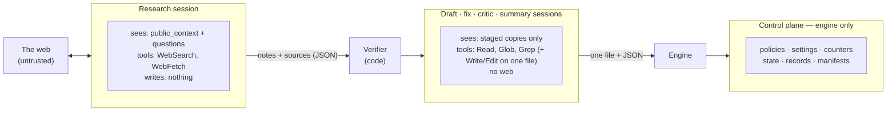

# 07 — Security

Status: Draft · Target: v0.1

spadework runs AI sessions unattended, and some of them read untrusted web
content. The design assumes that **any web page may contain instructions
aimed at the model**, and it makes sure that obeying them cannot hurt the
user. This document is normative. A change that weakens an invariant needs
an ADR.

## Threat model

| | |
|---|---|
| **Assets** | ① Confidential project information (the brief and inputs). ② The user's machine: files, credentials, shell. ③ The user's money and usage quota. ④ The integrity of the pack a human will act on. |
| **T1 — prompt injection via web content** *(primary)* | A fetched page tells the model to exfiltrate data, tamper with the sandbox, poison later sessions, or write misleading content. |
| **T2 — a malicious or careless third-party playbook** | Pursues the same goals through templates and prompts. |
| **T3 — model error** | The model writes somewhere it shouldn't, loops, or overspends. |
| **T4 — malicious source URLs during verification** | Server-side request forgery (SSRF) against the user's local network. |
| **Out of scope** | A compromised Claude Code binary or Python environment. A user who deliberately turns protections off. Supply-chain risk is reduced separately with a minimal set of dependencies and a lockfile. |

## Invariants

Every invariant has an enforcement mechanism and a test in `tests/security/`.

### I1. No code execution, no delegation, no MCP

Every kind of session has an explicit tool **allowlist** ([04](04-engine.md#session-kinds)).
Shell, REPL, notebook, subagent (`Task`/`Agent`) and MCP tools are never
available. Enforced three times: by the CLI `--tools` list, by
`--strict-mcp-config` with no MCP config, and by the guard, which denies any
tool not on the allowlist, including every `mcp__*` name.

### I2. Reads are confined to the staging directory

Each session runs in a fresh staging directory that holds **copies** of only
the files it needs. The guard resolves every path argument (`file_path`,
`path`, `notebook_path`) with `realpath` and requires it to be inside the
staging directory. Glob and Grep patterns (`pattern`, `glob`) must be
relative and must not contain `..`. Absolute patterns are denied. Restricted
mode ([05](05-executors.md)) adds another layer where it is available.

### I3. At most one writable path, matched exactly

The policy lists the exact absolute paths that may be written: zero for
research and critic sessions, one for all the others. Write and Edit calls to
any other path are denied, even inside the staging directory. After a
session, any file in the staging directory other than the expected output
produces a warning and is never copied back.

### I4. Sessions cannot reach the control plane

Guard policies, settings files, tool-call counters, the deadline, state,
records and manifests all live in `.spadework/` **outside** every staging
directory. Sessions can neither read nor write them. The engine regenerates
the policy and settings for **each** session and never reuses them between
sessions.

*(This is the flaw in the prototype. Sessions could write the settings file
that configured the guard for the next session.)*

### I5. No session has both confidential context and web access

This breaks the "lethal trifecta" of private data, untrusted content and an
outbound channel in the same session.

- **Research sessions** see only `public_context` and the research
  questions. The questions are rendered from a template context that
  contains nothing else ([03](03-playbooks.md#templates)). Their staging
  directory is empty, and they write nothing to disk.
- **Every other session** has no WebSearch or WebFetch.
- `spadework check --show-public` shows exactly what research sessions will see.

### I6. The guard fails closed

The guard denies the call when the payload cannot be parsed, the policy is
missing or invalid, the tool is unknown, the deadline has passed, or the
guard hits an internal error.

### I7. Everything is bounded

Per-session caps on tool calls (searches, fetches, total calls), per-session
and per-run budgets, and per-session and per-run time limits. They are
enforced by the engine, the CLI's `--max-budget-usd`, and the guard (the
deadline and the counters).

### I8. Playbooks cannot run code

Templates are rendered with Jinja2's `SandboxedEnvironment` and
`StrictUndefined`, with no filesystem loader beyond the playbook's own
directory. Playbooks cannot declare hooks, tools, executors or code
validators ([ADR 0004](../decisions/0004-playbooks-are-data.md)).
Playbook paths must stay inside the playbook directory.

### I9. Verification fetches cannot reach private networks

The verifier allows only `http` and `https`. It resolves DNS itself and
refuses loopback, private, link-local, multicast and reserved addresses. It
repeats that check on **every** redirect, with at most 5 redirects. It does
not send credentials in the URL, cookies or auth headers. It caps responses
at 2 MB and 10 s, and it identifies itself as `spadework/<version>`.

### I10. spadework itself writes only inside the project

The only exceptions are the user's Claude Code installation, which manages
its own files under `~/.claude` (kept to a minimum by
`--no-session-persistence`), and the OS temporary directory, if staging is
ever moved there.

### I11. Denials are visible

Every guard denial is logged with the tool call that triggered it, counted
in the manifest (`guard_denials`), and shown in the live view. A research
session with denials is flagged in the summary as *possible prompt injection
encountered*.

## Trust boundaries



## The guard

It is configured as a `PreToolUse` hook with matcher `*` in each session's
generated settings file:
`python -m spadework.sandbox.guard --policy <abs path in .spadework/control/>`.

**Policy file**, written by the engine and unreachable by the session:

```json
{
  "schema_version": 1,
  "session_id": "003-references-research",
  "workdir": "/…/.spadework/sessions/003",
  "allowed_tools": ["WebSearch", "WebFetch"],
  "writable": [],
  "deadline_epoch": 1790550000,
  "caps": { "WebSearch": 6, "WebFetch": 8, "total": 80 },
  "counters_path": "/…/.spadework/control/003.counters.json",
  "denials_path": "/…/.spadework/control/003.denials.jsonl"
}
```

**Checks, in order:** parse the payload → load the policy → deadline → tool
is on the allowlist → per-tool arguments (paths, patterns, and for
`WebFetch`, an `http(s)` URL whose host is not a literal loopback or private
address) → caps (counters incremented under a file lock) → allow. The first
failure denies with exit code `2` and a one-line reason that the model sees.

The guard is plain standard-library Python. It imports nothing outside the
standard library, starts fast, and is easy to audit.

## Residual risks

| Risk | Mitigation | Status |
|---|---|---|
| Injected web content biases research notes, which leads to misleading content in the pack | Quote verification, the critic's fabrication test, `[unverified]` labelling, human review, denial flags | Reduced, not eliminated. The pack must be reviewed by a human. |
| The user puts confidential information in `public_context` | Required field, `check --show-public`, and documentation | User's responsibility |
| Search queries reveal terms taken from `public_context` to the search provider | Inherent to web research | Accepted |
| A Claude Code bug weakens `--tools` or the hook | Several layers; `doctor --canary` checks live that a read outside the workdir and a write to a second file are both denied | Monitored |
| Local logs contain the brief and inputs | Kept in `.spadework/`, which `init` gitignores | Accepted |

## Reporting vulnerabilities

See `SECURITY.md`. Report privately through GitHub Security Advisories, not
through public issues.
